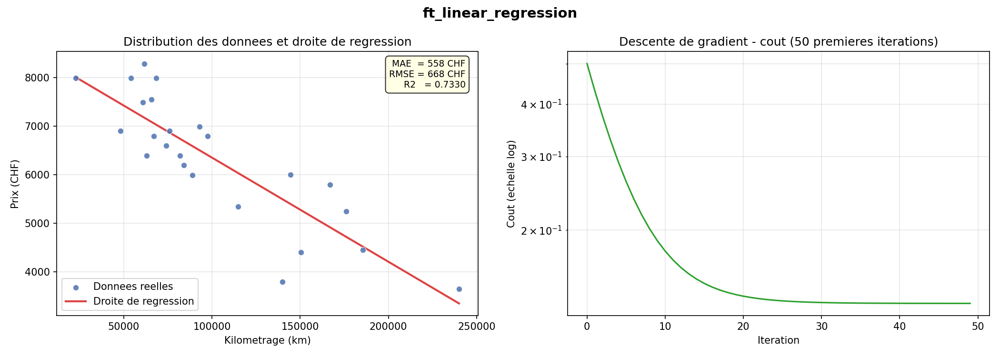

<div align="center">

# 📈 ft_linear_regression

### *Mon premier projet de machine learning — régression linéaire *from scratch* (aucune librairie ML)*


</div>



---

## 🎯 Aperçu

Prédire le **prix d'une voiture** à partir de son **kilométrage**, en implémentant la **descente de gradient** manuellement — sans `scikit-learn`, sans `numpy` pour la partie core.

L'objectif n'est pas la précision, mais de comprendre **comment un modèle apprend** : initialisation, itérations, normalisation, évaluation (MAE / RMSE / R²).

---

## 🎬 Démo


À gauche : nuage de points + droite apprise. À droite : évolution du coût (échelle log) pendant l'entraînement.

```
Metriques de precision :
  MAE  : 557.84 CHF  (erreur absolue moyenne)
  RMSE : 667.57 CHF  (erreur quadratique moyenne)
  R²   : 0.7330      (le modèle explique 73 % de la variance)
```

---

## C'est quoi ce projet ?

On veut prédire le **prix d'une voiture** à partir de son **kilométrage**.

L'idée : plus une voiture a roulé, moins elle vaut. On cherche donc une droite qui représente au mieux cette relation.

```
prix_estimé = theta0 + theta1 * km
```

- `theta0` = ordonnée à l'origine (le prix "de base")
- `theta1` = pente (combien le prix baisse par km supplémentaire, valeur négative)

Pour trouver les bons `theta0` et `theta1`, on utilise la **descente de gradient** : on part de zéro et on les ajuste petit à petit, des milliers de fois, jusqu'à minimiser les erreurs.

---

## Structure des fichiers

```
ft_linear_regression/
├── train.py          ← entraîne le modèle, sauvegarde thetas.json
├── predict.py        ← prédit un prix à partir d'un kilométrage
├── data.csv          ← le dataset (24 voitures : km + prix)
├── thetas.json       ← créé automatiquement par train.py
└── regression_plot.png  ← créé automatiquement par train.py (bonus)
```

---

## Installation

Python 3.x suffit. Pour les graphiques (bonus), il faut `matplotlib` :

```bash
pip install matplotlib
```

---

## Utilisation

### 1. Entraîner le modèle

```bash
python3 train.py
```

Ce programme :
1. Lit `data.csv`
2. Normalise les données (pour stabiliser la descente de gradient)
3. Fait 10 000 itérations de descente de gradient
4. Sauvegarde `theta0` et `theta1` dans `thetas.json`
5. Affiche les métriques de précision (MAE, RMSE, R²)
6. Génère `regression_plot.png` avec deux graphiques

Exemple de sortie :

```
==================================================
   ft_linear_regression  -  Entrainement
==================================================

[1/5] Lecture du dataset...
      24 voitures chargees.
[2/5] Normalisation des donnees...
[3/5] Descente de gradient (10000 iterations, lr=0.1)...
[4/5] Denormalisation des thetas...
      theta0 = 8499.5996
      theta1 = -0.021449
[5/5] Thetas sauvegardes dans thetas.json

----------------------------------------
  Metriques de precision :
    MAE  : 557.84 s  (erreur absolue moyenne)
    RMSE : 667.57 CHF  (erreur quadratique moyenne)
    R2   : 0.7330         (1 = parfait, 0 = nul)
----------------------------------------
```

### 2. Prédire un prix

```bash
python3 predict.py
```

```
==================================================
   ft_linear_regression  -  Prediction
==================================================

Entrez le kilometrage (km) : 80000

  Kilometrage entre  : 80,000 km
  Prix estime        : 6,783.68 CHF
```

> **Important** : lancez `train.py` avant `predict.py`. Sans `thetas.json`, les deux thetas valent 0 et la prédiction sera toujours 0.

---

## Comment ça marche — la descente de gradient

### Le problème

On a 24 paires `(km, prix)`. On veut trouver `theta0` et `theta1` tels que :

```
estimer_prix(km) = theta0 + theta1 * km
```

soit le plus proche possible des vrais prix.

### La solution : répéter ces étapes

Pour chaque itération :

1. **Calculer l'erreur** pour chaque voiture :
   ```
   erreur[i] = estimer_prix(km[i]) - prix[i]
   ```

2. **Calculer les ajustements** (formules du sujet) :
   ```
   tmp0 = learning_rate * (1/m) * somme(erreur[i])
   tmp1 = learning_rate * (1/m) * somme(erreur[i] * km[i])
   ```

3. **Mettre à jour les thetas simultanément** :
   ```
   theta0 = theta0 - tmp0
   theta1 = theta1 - tmp1
   ```

> `m` = nombre de voitures dans le dataset  
> `learning_rate` = taille du pas (0.1 dans ce projet)

### Pourquoi normaliser ?

Les km sont dans les centaines de milliers et les prix dans les milliers. Cette différence d'échelle rend la descente de gradient très lente ou instable. On normalise donc les données avant l'entraînement :

```
valeur_normalisee = (valeur - moyenne) / ecart_type
```

Après l'entraînement, on "dénormalise" les thetas pour qu'ils fonctionnent avec les vraies valeurs.

---

## Les graphiques (bonus)

`regression_plot.png` contient deux graphiques :

| Graphique | Ce qu'il montre |
|-----------|-----------------|
| Gauche | Nuage de points (données réelles) + droite de régression |
| Droite | Evolution du coût sur les 50 premières itérations (échelle log) |

Le graphique de coût est en **échelle logarithmique** car la descente est très rapide au début et le coût devient minuscule ensuite — sans log, la courbe paraît plate.

---

## Les métriques de précision (bonus)

### MAE (Mean Absolute Error) — Erreur Absolue Moyenne

**Formule** : $\text{MAE} = \frac{1}{m} \sum_{i=1}^{m} |\text{erreur}_i|$

**Interprétation** : En moyenne, on se trompe de X CHF en valeur absolue. Si MAE = 557.84 CHF, cela veut dire qu'en moyenne notre prédiction s'écarte de 557.84 CHF du prix réel.

**Exemple** : Avec des erreurs de [+200, -300, +150], MAE = (200 + 300 + 150) / 3 = **216.67 CHF**.

---

### RMSE (Root Mean Square Error) — Racine de l'Erreur Quadratique Moyenne

**Formule** : $\text{RMSE} = \sqrt{\frac{1}{m} \sum_{i=1}^{m} \text{erreur}_i^2}$

**Interprétation** : Comme le MAE, mais **pénalise davantage les grandes erreurs** (car on élève au carré). Si un modèle fait une grosse erreur sur une seule voiture, le RMSE sera beaucoup plus important que le MAE.

**Exemple** : Avec les mêmes erreurs [+200, -300, +150] : RMSE = $\sqrt{(200^2 + 300^2 + 150^2) / 3} = \sqrt{\frac{140000}{3}} \approx 216.33$ CHF. Mais avec [+200, -600, +150] : MAE = 316.67 mais RMSE = $\sqrt{\frac{440000}{3}} \approx 382.37$ → le RMSE a bien plus augmenté.

---

### R² (Coefficient de Détermination)

**Formule** : $R^2 = 1 - \frac{SS_{\text{res}}}{SS_{\text{tot}}}$

Où :
- $SS_{\text{res}} = \sum_{i=1}^{m} (\text{prix}_i - \text{prédiction}_i)^2$ (résidus au carré)
- $SS_{\text{tot}} = \sum_{i=1}^{m} (\text{prix}_i - \overline{\text{prix}})^2$ (variance totale)

**Interprétation** : 
- **R² = 1** → le modèle prédit parfaitement (impossible en pratique)
- **R² = 0.73** (comme dans notre cas) → le modèle explique 73% de la variance des prix. Les 27% restants sont dus au kilométrage n'étant pas le seul facteur du prix
- **R² = 0** → le modèle ne prédit pas mieux qu'une simple moyenne
- **R² < 0** → le modèle est pire qu'une simple moyenne (très mauvais)

**Exemple simple** : Si tous les prix réels étaient identiques à leurs prédictions, R² = 1. Si les prédictions valaient juste la moyenne (pas de droite), R² = 0.

---

## 🔌 Extensions (bonus hors-sujet)

Autour du modèle, j'ai ajouté quelques briques pour transformer le projet en mini-pipeline ML :

| Fichier | Rôle |
|---------|------|
| `scraper_autoscoot24.py` | Scrape des annonces de voitures réelles (km + prix) pour remplacer le dataset d'exemple |
| `monitor.py` | Surveille la dérive du modèle entre deux entraînements |
| `telegram_bot.py` | Envoie les prédictions / alertes via un bot Telegram |
| `config.py` | Centralise les hyperparamètres (learning rate, itérations, chemins) |

Documentation détaillée : [`ARCHITECTURE.md`](./ARCHITECTURE.md) · [`MONITORING_SETUP.md`](./MONITORING_SETUP.md) · [`INDEX.md`](./INDEX.md)

---

## 🎓 Ce que j'ai appris

- **Comprendre** avant d'utiliser — écrire la descente de gradient à la main avant de toucher à `scikit-learn`
- **Normalisation** : pourquoi elle est indispensable quand les features ont des échelles différentes (km × 10⁵, prix × 10³)
- **Métriques** : MAE / RMSE / R² ne racontent pas la même histoire — un modèle peut avoir un bon MAE et un mauvais R²
- **Pipeline ML** : un modèle seul ne sert à rien ; le scraping (données fraîches), le monitoring (dérive) et la diffusion (bot) sont aussi importants que la partie "apprentissage"
- **Math → code** : traduire des formules $\Sigma$, dérivées partielles, gradients en boucles Python

---

## 🗺️ Roadmap

- [ ] Support de **plusieurs features** (régression multiple : km + année + marque)
- [ ] Comparaison avec `scikit-learn` pour valider l'implémentation
- [ ] Cross-validation k-fold au lieu d'un simple split
- [ ] Export du modèle au format ONNX / pickle
- [ ] Interface web minimaliste (Flask) pour faire des prédictions en live

---

## 📜 Contexte

Projet réalisé dans le cadre du cursus **[42 Lausanne](https://42lausanne.ch/)** (outer circle ML).
Sujet officiel : *ft_linear_regression* — implémentation d'une régression linéaire sans librairie ML.

